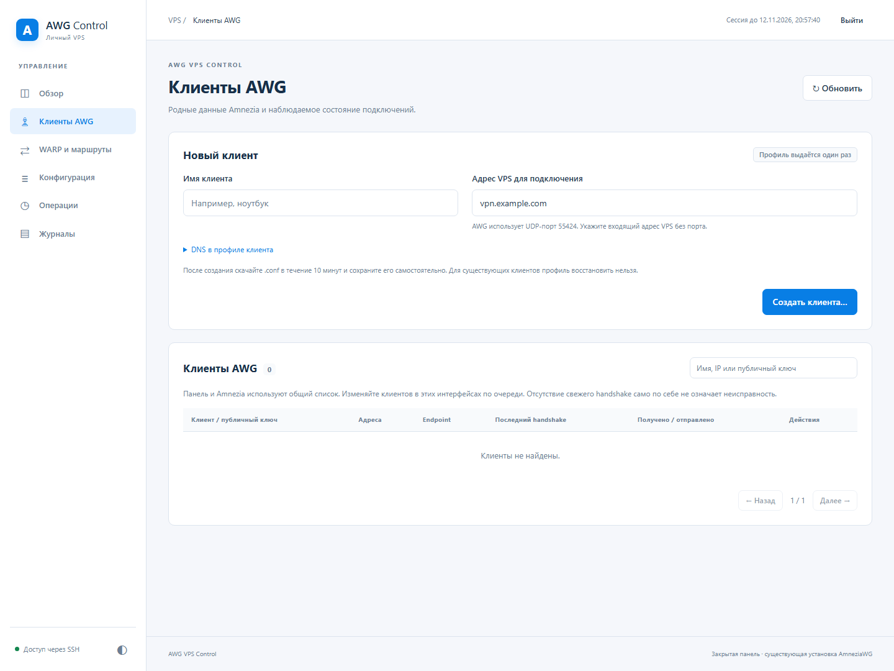

# Клиенты AWG

Доступно в `develop`, начиная с `0.2.0-dev.1`. Опубликованный `v0.1.0-rc.1`
содержит только просмотр клиентов.

## Создать подключение

1. Откройте **Клиенты AWG** и заполните имя нового клиента.
2. Проверьте входящий адрес VPS и DNS. Панель предлагает публичный IPv4 физического
   интерфейса и адрес AmneziaDNS; при отсутствии AmneziaDNS — `1.1.1.1`.
   При NAT или нескольких адресах укажите IP либо доменное имя вручную, без порта.
   Адрес выхода WARP для подключения не используется. DNS текущего профиля — IPv4.
3. Подтвердите создание. Панель откроет **Операции** и дождётся проверки файлов
   Amnezia и работающего интерфейса AWG.
4. Нажмите **Скачать .conf** и сохраните файл в течение десяти минут. Импортируйте
   его в клиент Amnezia с поддержкой версии AWG вашего сервера.

Профиль скачивается один раз. Приватный ключ клиента находится только в памяти
Adapter до выдачи или истечения срока. Обновление/перезапуск Adapter теряет ещё
не скачанные профили. Если файл потерян или ответ на скачивание оборвался,
отзовите клиента и создайте нового. Профили ранее созданных в Amnezia клиентов
панель восстановить не может: сервер не хранит их приватные ключи.

Серверные PSK и параметры обфускации сохраняются; используется свободный адрес
существующей клиентской подсети. Создание не перезапускает AWG.

## Переименовать или отозвать

**Переименовать** меняет имя в штатном `clientsTable`. Сохранённый профиль
продолжает работать, дата создания и сторонние поля остаются прежними.

**Отозвать доступ** удаляет peer из серверной конфигурации и runtime, а запись —
из `clientsTable`. Его старый профиль больше не подключается. Для нового доступа
создайте нового клиента. Временного отключения и повторной выдачи ключей нет.

Панель и Amnezia используют те же файлы внутри контейнера. Выполняйте изменения
в этих интерфейсах по очереди, затем обновляйте список. Если ревизия изменилась,
панель отклонит старое действие и предложит перечитать данные; автоматического
повтора с новой ревизией нет.

## Незавершённая операция

До изменения создаётся закрытая транзакция в
`/opt/amnezia/awg/.awg_vps_control/active` внутри AWG-контейнера. `owner` содержит
ID операции, `phase` — стадию; `old.conf`/`old.clients` и `next.conf`/`next.clients`
содержат серверные конфигурации. В них нет приватного ключа нового клиента.
Успешно проверенная транзакция перемещается в `last`, сохраняется одна предыдущая
транзакция. Права каталога — 0700, резервных файлов — 0600.

После сбоя панель не повторяет изменение вслепую. Незавершённый `active` блокирует
новые записи. Проверьте по SSH ID контейнера, стадию, хеши обоих native файлов,
состав peers и их AllowedIPs в runtime. При чужих изменениях сохраните их перед
ручным согласованием конфигурации и `clientsTable`. Удаление `active` само по себе
не восстанавливает данные. Не переносите содержимое серверных конфигураций в
публичные отчёты: они содержат серверные ключи и PSK.

После первого клиентского действия журнал содержит новые типы операций.
Штатное обновление/откат проверяет, умеет ли целевой Control читать этот журнал;
возврат к `v0.1.0-rc.1` будет отклонён до переключения служб. Не удаляйте журнал
для обхода проверки. Прямой запуск старого установщика в обход текущего менеджера
не поддерживается.

Подробности контракта: [API](api.md), [модель данных](peer_data_model.md).
