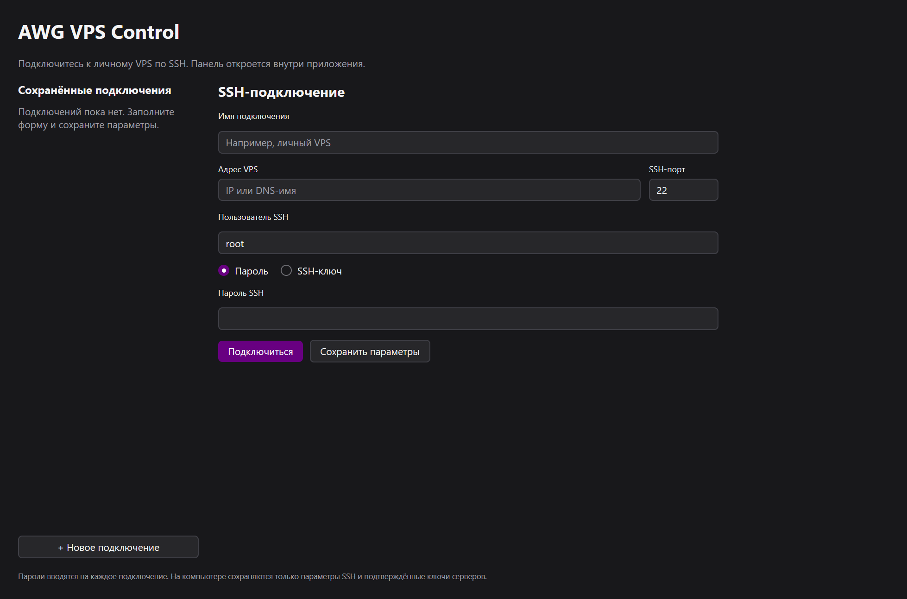

# Desktop-клиент для Windows

Настольная оболочка находится в `develop`. Она открывает существующую панель VPS
внутри своего окна через SSH. VPN продолжает работать при закрытии приложения.
На VPS не появляется публичный HTTP-порт; Docker и WARP не меняются.

Это preview: прямое подключение к VPS и системный Save-диалог ещё ожидают
приёмки. Встроенная панель проверена через локальный SSH-стенд и существующее
административное соединение; подробности — в протоколе ниже.



## Получить приложение

Первая платформа — Windows 10/11, amd64, установленный Microsoft Edge WebView2
Runtime. Основа — [MyGo v0.9.0](https://github.com/egoist/mygo/tree/v0.9.0),
отдельный модуль Go 1.27.4. Другие ОС пока не прошли приёмку.

После успешного [Desktop Windows workflow](https://github.com/khorevaa/awg-vps-control/actions/workflows/desktop_windows.yml)
скачайте артефакт `awg_vps_desktop_windows_amd64`. Внутри — portable ZIP и его
SHA-256. Проверьте SHA-256 командой `Get-FileHash`, распакуйте ZIP и запустите
`awg_vps_desktop.exe`. Установка приложения и права администратора на PC не нужны.
Бинарник пока не подписан сертификатом издателя.

Для сборки из исходников:

```powershell
./scripts/build_desktop.ps1 -Go 'C:\path\to\go.exe'
```

Нужен Go 1.27.4 или совместимый более новый SDK. Скрипт собирает только Windows
desktop, отключает inspector и не меняет серверные модули. Результат находится
в `dist/desktop`. Корневой `go.work` обслуживает сервер; при самостоятельных
командах внутри `desktop` задавайте `$env:GOWORK = 'off'`.

## Подключиться

1. Укажите название, IP/DNS-имя VPS, SSH-порт и пользователя. Для штатной установки
   используйте root: требуется чтение `/etc/awg_vps_control/ui.env` и открытие
   `/run/awg_vps_web/web.sock` через SSH streamlocal forwarding.
2. Выберите пароль либо файл приватного ключа OpenSSH/PEM. Зашифрованный ключ
   требует passphrase. PuTTY PPK, ssh_config aliases, ProxyJump и ssh-agent
   пока не поддерживаются.
3. «Сохранить параметры» добавляет подключение в локальный список. Пароль,
   passphrase, содержимое ключа и секрет панели туда не записываются.
4. Нажмите «Подключиться». Для нового сервера сверьте показанный SHA256 fingerprint
   с консолью провайдера. Подтвердите совпадение и повторите подключение; пароль
   потребуется ввести заново. Изменившийся доверенный ключ приложение отклоняет.
5. Внутри окна откроется обычная панель. Войдите её секретом доступа, полученным
   на VPS командой `awg-vps-control ui-access`.

Профили и отдельный `known_hosts` приложения находятся в
`%APPDATA%\awg_vps_control`. Глобальные настройки OpenSSH не меняются.
Для изолированного экземпляра доступен `-data-dir <абсолютный путь>`.
При переустановке VPS сначала независимо подтвердите новый ключ; редактирование
`known_hosts` выполняется вручную при закрытом приложении. Кнопки обхода проверки нет.

## Создать VPN-клиента и сохранить профиль

В разделе «Клиенты AWG» создайте клиента и запросите разовый `.conf`, как в
[веб-панели](client_management.md). В верхней полосе desktop появится
«Сохранить профиль .conf…». Нажмите её и выберите путь в системном диалоге.
Сообщение веб-панели о передаче браузеру ещё не означает запись на диск.

Desktop хранит полученный файл только в памяти до 10 минут. Отмена диалога,
отключение, закрытие приложения или истечение срока уничтожают его. Повторно
получить этот профиль с сервера нельзя; если файл не сохранён, отзовите клиента
и создайте нового. Пока сохранение не завершено, следующая выдача блокируется.
Файл `.conf` содержит приватный ключ — храните его как пароль.

## Отключение и ограничения

«Отключиться» закрывает WebView, его временную сессию и SSH-туннель. После этого
можно выбрать другой VPS. Автоматического повторения операций или ввода сохранённого
пароля нет; при потере SSH подключитесь заново.

Страница VPS работает в изолированном WebView без Go bindings, доступа к файлам
PC или SSH-ключу. Внешние переходы, новые окна, браузерные downloads и разрешения
устройств запрещены. Сохранение `.conf` выполняет native оболочка после отдельного
нажатия. Обычные браузерные функции загрузки иных файлов не поддерживаются.

Текущая приёмка и оставшиеся ограничения указаны в
[протоколе готовности](verification_status.md). Наличие desktop не закрывает
отдельные сетевые проверки первого WARP RC.
