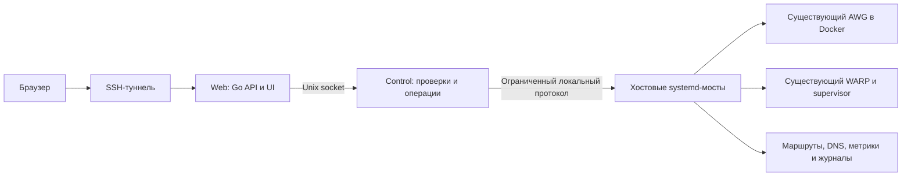

# План разработки awg-vps-control

Статус: план после анализа источников, 12 ноября 2026 года. Код приложения пока не создан. Основания и ограничения подтверждены в [анализе источников](source_analysis.md).

## 1. Цель и границы

Создать аналог панели `ocserv-vps` для одного VPS с существующим AmneziaWG и необязательным выходом через WARP. Сохранить стек, визуальный язык, закрытый доступ и разделение Web/Control/host operations.

Обязательная граница: проект **не устанавливает AWG**. Также в первоначальный объём не входят обновление/пересоздание AWG-контейнера, установка kernel module, замена VPN-ключей при подключении панели, установка Docker, регистрация или установка WARP. Эти компоненты обнаруживаются и проверяются как внешние зависимости.

Установка, обновление и удаление панели обслуживают только собственные бинарники, контейнеры, sockets, state и systemd units. Изменения peers, конфигурации VPN и маршрутов доступны как отдельные осознанные действия уже подключённой панели. Uninstall панели сохраняет работающий AWG и действующий режим выхода; direct не включается скрыто.

Первый поддерживаемый вариант: Ubuntu 24.04, Linux amd64, Docker Compose v2, существующая установка AWG2 и DNS из изученного чата. Имена контейнеров, интерфейсов, paths и сетей обнаруживаются и закрепляются в настройках. Версия протокола проверяется отдельно от имени контейнера. Нативный systemd AWG и другие поколения протокола — последующие адаптеры, без обещания поддержки до испытаний.

## 2. Сохраняемый стек

| Область | Решение |
| --- | --- |
| Backend | Go 1.26, стандартная библиотека; два модуля `ui/web` и `ui/control` |
| Frontend | HTML/CSS/vanilla JavaScript, `go:embed`, без npm и frontend-фреймворка |
| Состояние панели | Защищённые JSON-файлы с атомарной записью и версией схемы |
| Межсервисная связь | Unix socket, JSON lines, request ID, `SO_PEERCRED`, лимиты и deadlines |
| Доступ | SSH local forward к Unix socket Web, отдельный access secret, серверные сессии и CSRF |
| Развёртывание | Два изолированных UI-контейнера, Docker Compose v2, systemd-мосты |
| Хостовые утилиты | Bash; Python только там, где нужен проверенный parser существующих helpers |
| Выпуск | GitHub Actions, GHCR Web/Control, version/source/revision labels, checksum и rollback панели |
| Внешняя инфраструктура | Уже установленные AWG, Docker, Linux networking, при необходимости WARP и DNS |

Сохраняем конкретную структуру исходного проекта, не вводим общий корпоративный Go-шаблон с FX/ORM/очередями. При реализации применяем пользовательские правила: snake_case файлов, русские комментарии моделей/полей/функций, интерфейсы с `I`, SDD-модель перед Go DTO. Patch-версию Go и digests закрепляем при начале реализации, исходная сборка использует 1.26.5. Локальный SDK выбираем из `E:\gosdk` согласно правилам окружения.

## 3. Архитектура

### Границы полномочий

- Web не имеет доступа к AWG-конфигам, Docker socket, host networking, `NET_ADMIN` или приватным серверным ключам.
- Control валидирует intent и capability, формирует операции, но не получает универсальный Docker API или произвольный shell. Оба UI-контейнера остаются без сети.
- Host bridge выполняет фиксированный набор действий над заранее закреплёнными ресурсами. Он проверяет UID, operation ID, размер/схему payload, ревизию и владение path; ресурс нельзя подменить параметром из браузера.
- Команды запускаются через argv с timeout и ограниченным выводом. Секреты не попадают в argv, audit и stderr. Проверки сети выполняются на хосте/в нужном namespace через мост.
- Для Docker backend операции над файлами и `awg` выполняются в целевом namespace существующего контейнера. Панель не монтирует весь `/etc`, корень хоста или Docker socket.
- HTTP через localhost и Secure-cookie проверяем в поддерживаемых браузерах вместе с Bash/PowerShell SSH-helper. Публичного TCP listener панели на VPS нет.

### Обнаружение и принятие под управление

`discover` и `doctor` только читают состояние. Обнаруживаются container ID/image/version, AWG interface, CLI capabilities, persistent config, peer metadata, DNS, Docker network/bridge, source addresses, WARP mode и units.

При нескольких кандидатах оператор выбирает конкретный. Неизвестная топология, неподдерживаемые параметры, конфликтующие policy rule priorities, небезопасные paths и недостаточные права дают понятный read-only статус.

Операция подключения сохраняет описание установки и baseline. Существующие peers/ключи, конфиги и сети при этом не переписываются. Изменения внешним приложением Amnezia выявляются по ревизии; автоматической перезаписи чужих изменений нет.

### Источники истины

| Данные | Источник |
| --- | --- |
| Runtime peers, handshake, counters | Установленный AWG через host adapter |
| Persistent peers и параметры интерфейса | Обнаруженная конфигурация и, если требуется, подтверждённое хранилище метаданных Amnezia |
| Имена/заметки, не существующие в AWG | Отдельные метаданные панели по interface ID + public key |
| Сессии, аудит, задачи | State панели; отдельные файлы/блокировки для процессов-владельцев |
| WARP и supervisor | Состояние службы, read-only settings и структурированные результаты проверок |
| Маршруты и firewall | Фактический kernel state и manifest принадлежащих проекту объектов |

Не следует считать server public key источником client private key. Для существующего peer без доступного приватного клиентского ключа полный профиль восстановить невозможно. В UI это отдельное состояние, а не пустой или заведомо нерабочий экспорт.

## 4. Разделы интерфейса

| Раздел | Содержание и действия |
| --- | --- |
| Обзор | Uptime VPS, CPU/RAM/disk, состояние AWG/DNS/WARP/UI, peers, трафик, очередь операций и предупреждения |
| Клиенты | Peers, имя/заметка, public key, адрес, handshake, RX/TX; создать, отключить, включить, удалить, выдать профиль |
| Активность | Недавние handshakes и изменения counters с временем наблюдения; отсутствие handshake не равно доказанному offline |
| WARP и маршруты | Режим выхода, tunnel/interface, supervisor, DNS/HTTPS проверки, порядок правил, drift, последнее подтверждение |
| Параметры AWG | Поддерживаемые поля, endpoint/port, адреса, MTU и параметры обфускации с проверкой совместимости |
| Конфигурация | Маскированный просмотр, ревизия, ограниченное редактирование, diff, применение и результат rollback |
| Диагностика и журналы | Логи выбранных контейнеров/units, фильтры, пагинация, аудит операций, очищенный диагностический отчёт |
| Панель | SSH-helper, доступ/ротация секрета, версия, обновление и откат компонентов панели |

Сохраняем sidebar, CSS tokens, темы, карточки, модальные подтверждения, уведомления и русский язык. «Пользователи/пароли» заменяются моделью peers/ключей; «маскировка ocserv» — параметрами AWG. TLS/Let's Encrypt и сайты-заглушки не являются разделами этого продукта.

Создание клиента выдаёт `.conf` один раз; private key не сохраняется в обычном state, логах или localStorage. QR — локально, с закреплённой и проверенной библиотекой/утилитой, без стороннего HTTP-сервиса; дополнительную зависимость вводить только для этой функции. Повторный выпуск ключа — отдельная операция с предупреждением об отзыве прежнего доступа.

Отключение peer означает отзыв допуска в runtime и persistent state, а включение — его восстановление. Это не обещание завершить «сеанс» с семантикой ocserv. Статистика после restart может сбрасываться; UI показывает границы периода наблюдения.

## 5. WARP и защита маршрутизации

Поддержать два явных режима: `warp_required` и `direct`. Если WARP отсутствует, базовое управление AWG доступно; включение `warp_required` требует готовой совместимой инфраструктуры.

В `warp_required` отказ WARP блокирует клиентский выход. Автоматический direct fallback запрещён. Переход в direct — самостоятельная операция с предупреждением о смене исходящего IP и возможном разрыве подключения. Изученный direct-helper перезапускает AWG; это должно быть видно до запуска.

Сохраняем из прошлого решения:

- client source до хоста, отдельные правила для клиентского и DNS-трафика;
- порядок NAT/FORWARD/DOCKER-USER, корректный обратный маршрут;
- отделение outer AWG и SSH от клиентского egress;
- идемпотентность, контроль topology changes, backoff/cooldown;
- разделение ошибок HTTPS и DNS, проверку `warp=on|plus` после восстановления.

До разрешения записи устраняем известные ограничения:

1. Закрыть обход через SNAT в адрес контейнера при утрате preserve-source. Защита должна действовать в kernel path до очередного цикла supervisor и классифицировать происхождение трафика независимо от легко меняемого UDP source port. Выбранную схему подтвердить отрицательными сетевыми проверками.
2. Ограничить исключения SSH только административным потоком; клиентский трафик к тому же адресу не должен обходить WARP.
3. Определить владение rules/chains/routes и состояние после reboot. Чужие таблицы/правила не очищаются; существующие служебные зависимости выявляются, в том числе отсутствовавший в bundle SSH unit.
4. Для неподдерживаемого IPv6 явно блокировать клиентский IPv6 на управляемом пути или отказать в активации режима. Не менять глобально IPv6 VPS и не ломать административный SSH. Полноценный dual-stack вынести в отдельный этап совместимости.
5. Показывать отдельно: service active, tunnel connected, routing valid, HTTPS verified, DNS verified и время последней проверки. READY supervisor не означает исправный интернет.
6. Предусмотреть ограниченные периодические probes и ручную проверку; timeout внешней проверки не выдавать за доказанное повреждение всех маршрутов.

WARP proxy и Mihomo не входят в первый backend. Никакие Cloudflare credentials/registration keys не публикуются и не попадают в Web.

## 6. Модель операций и конфигурации

Любое сетевое или VPN-изменение имеет `operation_id`, actor, target, expected revision, timestamps, безопасный результат и состояния `queued`, `running`, `verifying`, `succeeded`, `rolling_back`, `rolled_back`, `failed`, `manual_recovery_required`.

Порядок выполнения:

1. Проверить доступ/CSRF/capabilities и записать intent в устойчивый журнал. Если записать intent нельзя, изменяющая операция не начинается.
2. Получить блокировку установки и согласовать её с supervisor. Повтор запроса с тем же idempotency key не создаёт второе действие.
3. Сверить runtime, persistent revision и metadata; при drift вернуть конфликт без перезаписи.
4. Сохранить snapshot изменяемых объектов и подготовить candidate. Для нескольких файлов использовать журнал транзакции и recovery markers; rename каждого файла сам по себе не делает всю операцию атомарной.
5. Провести структурную и version-aware валидацию. Не переносить команду `ocserv --test-config` на AWG и не считать `awg-quick strip` полной проверкой. Временная изолированная проверка backend допускается только при подтверждённых capabilities, без hooks и production routes.
6. Применить минимальный delta. Для peers предпочитать поддерживаемое runtime-изменение без общего restart; поддержку `syncconf`/аналогичного механизма определить по конкретным tools. Согласовать persistent state, runtime и metadata Amnezia.
7. Проверить фактический результат. Сетевые изменения подтверждать проверкой маршрутов/egress; изменение peers — сопоставлением runtime и persistent state. Отсутствие handshake у выключенного клиента не считать ошибкой создания peer.
8. При неуспехе восстановить только принадлежащие операции изменения, проверить восстановление и записать итог. Потеря ответа/перезапуск Web не отменяет host-side watchdog. Если rollback не удался, показать `manual_recovery_required` и безопасную инструкцию.

Для действий, способных затронуть SSH/маршруты, rollback timer работает независимо от браузера и UI-контейнеров. Успешный ответ systemctl/docker или создание trigger не означает завершённую операцию. UI получает `202` и читает отдельный endpoint статуса.

Произвольное редактирование shell hooks через UI запрещено. Существующие hooks сохраняются как непрозрачные защищённые поля; их изменение требует отдельного локального администрирования. `SaveConfig` и конкурентная запись Amnezia должны быть либо согласованы адаптером, либо переводить конфигурацию в read-only. Неизвестные параметры не удаляются при сериализации.

## 7. План реализации

### Этап 0. Контракты и границы адаптера

Подготовить `docs/data_model.md`, `docs/api.md`, `docs/operation_states.md` и `docs/compatibility.md`. Сущности: ManagedInstallation, Interface, Peer, PeerMetadata, ClientProfileDelivery, EgressPolicy, RuntimeSnapshot, DiagnosticCheck, Operation, BackupManifest, AuditEvent и Session. Описать поля, секретность, источники истины и инварианты до появления Go-моделей.

Определить реальный persistent store Amnezia, поддержку AWG-команд и правила совместного владения. Локальную карту `.agents/agent_project_map.md` создать перед кодированием; каталог остаётся вне Git. Публичные спецификации и согласованный план хранятся в `docs/`.

**Приёмка:** матрица read/write capabilities, source-of-truth и policy `no_awg_install` однозначны; неподдерживаемая установка имеет read-only результат. Метаданные существующих клиентов не выдумываются.

### Этап 1. Основа панели и защищённый доступ

Перенести независимые части Web/Control, frontend shell, темы, auth/CSRF/audit, JSON storage, Unix transport и SSH helpers. Сохранить уведомления об исходной лицензии при переносе кода; не копировать ошибочные OCI labels без проверки. Host bridge пока предоставляет healthcheck и read-only snapshot.

**Приёмка:** панель доступна через SSH, без публичного TCP порта и Docker socket; Web/Control изолированы, сессия и logout работают, секреты не присутствуют в URL/логах. Сбой записи intent блокирует mutation.

### Этап 2. Подключение существующей установки и обзор

Реализовать `discover`, `attach`, `doctor`, overview VPS/AWG/DNS, read-only peers/handshakes/counters, logs и capability diagnostics. Добавить первую версию installer, которая ставит только панель и мосты.

**Приёмка:** повторная установка идемпотентна; checksum AWG-конфигурации, peers, ключи, container ID и сети не изменились. Отсутствие AWG даёт диагностическую ошибку, не запускает installer AWG. Контейнеры и сети с несколькими кандидатами не выбираются случайно.

### Этап 3. Наблюдение за WARP и маршрутизацией

Подключить read-only adapter к имеющимся WARP/supervisor и обезличенные контракты из прошлой работы. Реализовать отдельные статусы службы, маршрутов, HTTPS и DNS, время проверки и журнал восстановления. Внедрить безопасные probes с ограничением частоты и destinations.

**Приёмка:** `active` без рабочего DNS/egress не отображается как полный успех. Панель различает missing dependency, stale result и реальную неисправность. Выход в direct самопроизвольно не включается.

### Этап 4. Транзакции и управляемое восстановление

Реализовать operation journal/status, locks, snapshot, idempotency и recovery после сбоя процесса. Адаптировать restore/update helpers, устранить окно обхода при SNAT, ограничить SSH exception и обработать IPv6. Добавить repair/reconnect WARP, управление supervisor и явное переключение egress.

**Приёмка:** на изолированном стенде потеря WARP, preserve-source, изменение порядка правил и restart Docker не дают незаявленного прямого выхода. Ошибка rollback видна оператору. Обновление helper не выдаётся за атомарную транзакцию всей сети. При переключении режима сохраняется административный путь.

### Этап 5. Peers, профили и конфигурация

Добавить создание/отключение/включение/удаление peers, адресный allocator, защиту от конфликтов public key/IP, импорт с preview и merge по умолчанию, одноразовую выдачу `.conf` и QR. Server AllowedIPs и client AllowedIPs валидируются отдельно. Метаданные Amnezia обновлять только через проверенный адаптер; иначе ограничить операции.

Внедрить редактор поддерживаемых AWG-полей с маскированными секретами, SHA-256/revision, diff и транзакцией. Изменение port, endpoint и обфускации предупреждает о необходимости обновить клиентские профили. Массовая замена, key rotation и raw hooks не входят в первый простой CRUD.

**Приёмка:** новые peers работают с реальным клиентом; отключённый peer не восстанавливается после restart; создание не разрывает остальные подключения без необходимости. Drift возвращает 409. Профиль существующего peer без private key недоступен с понятной причиной. Недопустимый candidate не меняет активный VPN.

### Этап 6. Обслуживание и выпуск панели

Добавить CLI/меню `awg-vps-control`: `discover`, `attach`, `doctor`, `status`, `install-ui`, `update-ui`, `rollback-ui`, `ui-access`, `rotate-ui-access`, `logs`, `uninstall-ui`. Операции AWG/WARP отделить от lifecycle самой панели. Подготовить GHCR Web/Control, manifests/checksums, совместимость версий, healthcheck и откат.

**Приёмка:** install/update/uninstall панели не устанавливают и не обновляют AWG, не пересоздают его контейнер и не переключают egress. При удалении панели необходимые для действующего режима helpers сохраняются до отдельного безопасного отключения. Обновление не теряет state/audit и не перезаписывает ручные изменения.

### Этап 7. Приёмка на Linux и документация

Пройти сценарии из следующего раздела на одноразовом стенде, затем на подключённой тестовой установке с реальным клиентом. Подготовить руководство подключения, совместимости, backup/recovery, удаления и скриншоты. Зафиксировать первый release только после проверки kernel networking и восстановления после reboot.

**Приёмка:** ограничения явно документированы; все обязательные сценарии пройдены. Поддержка production-топологии не объявляется по результатам одной сборки или только namespace probes.

Последовательность: **0 → 1 → 2 → 3 → 4 → 5 → 6 → 7**. После этапа 3 получается пригодная для просмотра панель; право изменять сеть появляется после прохождения этапа 4.

## 8. Проверки и критерии готовности

Проверки сборки: `gofmt`, `go vet`, `go build` по обоим модулям, существующие унаследованные тесты, `bash -n`, `node --check`, сборка контейнеров, проверка Compose и systemd units. CI actions/build images закрепляются версиями и digest/SHA.

По правилам пользователя новые API-тесты создаются в JetBrains HTTP Client `.http`, только с проверкой ожидаемого статуса ответа. Новые `*_test.go` без отдельного запроса не создавать. Проверки сетевого поведения ниже — сценарии приёмки стенда с протоколом наблюдений; они не подменяются HTTP-статусом.

| Сценарий | Ожидаемый результат |
| --- | --- |
| Установка панели поверх рабочего AWG | Тот же контейнер, конфигурация, ключи и доступ клиентов |
| Повторный attach, несколько сетей/контейнеров | Идемпотентность или явный выбор; нет скрытой записи |
| Создание/отключение peer и restart AWG | Runtime и persistent state совпадают; отзыв сохраняется |
| Конкурентное изменение через Amnezia | Конфликт ревизии, без потери внешних изменений |
| Ошибка validation/apply/restart и потеря питания процесса | Восстановление или явно обозначенный ручной recovery |
| Потеря WARP, DNS отдельно от HTTPS | Нет direct fallback; диагностируется правильный компонент |
| Удаление preserve-source, перестановка NAT/firewall | Нет обхода через SNAT; управление остаётся доступно |
| VPN-пакет к SSH peer или с подобранным UDP source port | Не получает административное исключение |
| IPv6 при режиме WARP | Проверенный маршрут либо блокировка клиентского IPv6 без повреждения SSH |
| Restart Docker/WARP, смена bridge/IP, reboot VPS | Повторное обнаружение и корректный порядок восстановления |
| Реальное удалённое AWG-подключение | Handshake, DNS и HTTPS проходят через ожидаемый выход |
| Подмена Host/Origin/CSRF, неверный Unix UID | Запрос отклонён, изменение не выполнено |
| Логи, экспорт диагностики, аудит | Нет private keys, PSK, access secret и WARP credentials |
| Update/rollback/uninstall панели | AWG и выбранный egress сохранены, чужие ресурсы не удалены |

## 9. За пределами первого выпуска

Multi-VPS control plane, роли нескольких администраторов, биллинг/квоты, Kubernetes, установка AWG/WARP, обновление AWG runtime, универсальный shell/file manager, автоматическая смена протокола и перенос ocserv TLS/camouflage. Нативный AWG backend, полноценный dual-stack и другие версии протокола добавляются по отдельной матрице совместимости.

Нужно уточнить во время этапа 0, без изменения выбранного стека: формат metadata реальной Amnezia-установки, перечень поддерживаемых клиентов, безопасную схему классификации пакетов при SNAT и точный список приобретаемых под управление host resources. До этого соответствующие операции остаются read-only.
