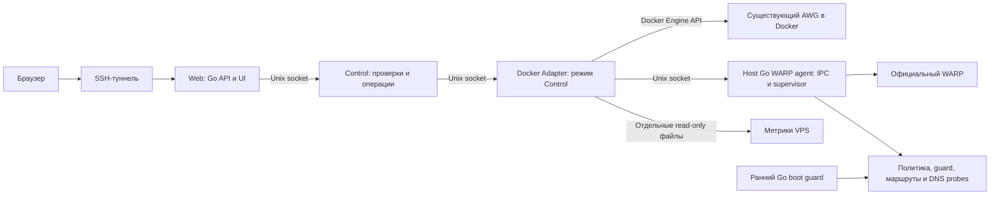

# План разработки awg-vps-control

Статус: требования подтверждены пользователем после разбора идеи, 12 ноября 2026 года. Реализация первого выпуска `0.1.0-dev` проходит интеграционные испытания. Основания и ограничения подтверждены в [анализе источников](source_analysis.md). Согласованные ниже решения заменяют первоначальные допущения плана.

Текущие результаты и блокирующие дефекты ведутся в [протоколе готовности](verification_status.md). Выпуск по тегу и автоматическая сборка контейнеров описаны в [руководстве выпуска](release_guide.md). Наличие реализации не означает завершённую приёмку этапа.

## 1. Цель и границы

Создать аналог панели `ocserv-vps` исключительно для личных VPS пользователя с существующим AmneziaWG и необязательным выходом через WARP. На каждом VPS — отдельная панель, один владелец и доступ через SSH-туннель. Сохранить стек, визуальный язык, закрытый доступ и разделение Web/Control/Adapter/WARP operations. По уточнению пользователя systemd обслуживает только хостовую логику WARP и раннюю защиту; остальные процессы панели работают в Docker. Публичность репозитория не означает обязательства поддерживать сторонних администраторов или универсальные установки VPN.

Установка панели сама **не устанавливает AWG**. По последующим уточнениям пользователя отдельная ручная команда `install-awg` перенесена в текущий этап; она устанавливает новый AWG в Docker из официальных серверных скриптов Amnezia. Это явное изменение первоначального запрета. Обновление/пересоздание существующего AWG остаётся отдельной будущей задачей; замена ключей при подключении панели, установка kernel module на хост и установка Docker не входят в первый выпуск. Уже существующий AWG подключается без установки. WARP необязателен: допускается отдельная явная установка и настройка WARP с интеграцией с AWG. Уже настроенный WARP принимается после проверки без молчаливого сброса его регистрации или конфигурации.

**Первый выпуск — диагностика и восстановление AWG/WARP.** Управление клиентами через родные файлы Amnezia — следующий этап. В первом выпуске список peers и конфигурация доступны для наблюдения, а перезапуск AWG — отдельное ручное действие.

Установка, обновление и удаление самой панели обслуживают только её бинарники, контейнеры, sockets, state и systemd units. Установка WARP и настройка интеграции отделены от установки UI. Изменения маршрутов и правил выполняются при явной настройке интеграции либо разрешённом автовосстановлении. Uninstall панели сохраняет работающий AWG и выбранную политику выхода, включая значение разрешающей галочки.

Первый целевой профиль: Ubuntu 24.04, Linux amd64, Docker Compose v2, существующая Docker-установка AmneziaWG и DNS из изученного чата. Имена контейнеров, интерфейсов, paths и сетей обнаруживаются и закрепляются в настройках. Версия протокола проверяется отдельно от имени контейнера. Нативный systemd AWG и другие поколения протокола — последующие адаптеры, без обещания поддержки до испытаний.

## 2. Сохраняемый стек

| Область | Решение |
| --- | --- |
| Backend | Go 1.26.9, стандартная библиотека; два модуля `ui/web` и `ui/control`; Adapter и WARP — режимы бинарника Control |
| Frontend | HTML/CSS/vanilla JavaScript, `go:embed`, без npm и frontend-фреймворка |
| Состояние панели | Защищённые JSON-файлы с атомарной записью и версией схемы |
| Межсервисная связь | Unix socket, JSON lines, request ID, `SO_PEERCRED`, лимиты и deadlines |
| Доступ | SSH local forward к Unix socket Web, отдельный access secret, серверные сессии и CSRF |
| Развёртывание | Три контейнера Web/Control/Adapter, два scratch image, Docker Compose v2; systemd только WARP agent и boot guard |
| Хостовые утилиты | Go и Bash, без Python runtime; IPC и supervisor WARP в одном Go-процессе |
| Выпуск | GitHub Actions, GHCR Web/Control, version/source/revision labels, checksum и rollback панели |
| Внешняя инфраструктура | Уже установленные AWG, Docker, Linux networking и используемый DNS; WARP подключается или устанавливается отдельно |

Сохраняем конкретную структуру исходного проекта, не вводим общий корпоративный Go-шаблон с FX/ORM/очередями. При реализации применяем пользовательские правила: snake_case файлов, русские комментарии моделей/полей/функций, интерфейсы с `I`, SDD-модель перед Go DTO. Исходная сборка ocserv использует Go 1.26.5; для текущего проекта закреплён Go 1.26.9. Локальный SDK выбираем из `E:\gosdk` согласно правилам окружения.

## 3. Архитектура

### Границы полномочий

- Web не имеет доступа к AWG-конфигам, Docker socket, host networking, `NET_ADMIN` или приватным серверным ключам.
- Control валидирует intent и capability, формирует операции и хранит журнал, но не получает Docker socket или произвольный shell. Все три контейнера работают с `network_mode: none`, read-only rootfs, `cap_drop: ALL` и no-new-privileges.
- Docker Adapter выполняет фиксированный набор действий через Docker Engine API над заранее закреплёнными контейнерами. Он проверяет UID, request ID, размер/схему payload, ревизию и допустимость ресурсов. Браузер не может передать произвольный exec, Docker API path, контейнер или host path. Adapter имеет UID 10003 и дополнительную фактическую группу Docker socket; Web UID 10001 и Control UID 10002 его не получают.
- Полный Docker socket у Adapter остаётся доверием уровня root, несмотря на non-root UID и read-only bind mount. Это явное изменение по сравнению с ocserv: существующий AWG не предоставляет заранее общего `occtl.sock` и mounts. Универсальный Docker API не экспортируется через Adapter IPC.
- Хостовый Go WARP agent обслуживает только WARP, политику, собственные правила/маршруты, probes и supervisor в одном процессе. Он повторно проверяет Adapter UID 10003, payload и закреплённые ресурсы. Ранний guard — отдельный oneshot; общие host/UI/supervisor systemd-службы удалены. Docker inspect и вход в проверенный network namespace допустимы только для WARP-маршрутизации, без входа в mount namespace хоста.
- Команды запускаются через argv с timeout и ограниченным выводом. Секреты не попадают в argv, audit и stderr. Файлы и `awg` читаются фиксированными Docker exec внутри существующего контейнера. Контейнеры панели не получают privileged, host PID/network namespace, mount всего `/etc` или корня хоста.
- Метрики hostname/uptime/load/memory поступают в Adapter из отдельных read-only файлов хоста; disk измеряет раздел данных панели. Конфигурация `/etc/awg_vps_control/host.json` и прежние пути Web/Control/host state сохраняются. Общей базы VPN-пользователей нет.
- Runtime-каталоги sockets создаёт tmpfiles `awg_vps_control.conf`; Compose и `restart: unless-stopped` обслуживают Web/Control/Adapter без systemd-обёртки. На хосте только `awg_vps_warp.service` и `awg_vps_guard.service`.
- HTTP через localhost и Secure-cookie проверяем в поддерживаемых браузерах вместе с Bash/PowerShell SSH-helper. Публичного TCP listener панели на VPS нет.

### Обнаружение и принятие под управление

`discover` и `doctor` только читают состояние. Обнаруживаются container ID/image/version, AWG interface, CLI capabilities, persistent config, peer metadata, DNS, Docker network/bridge, source addresses, WARP mode и units.

При нескольких кандидатах оператор выбирает конкретный. Неизвестная топология, неподдерживаемые параметры, конфликтующие policy rule priorities, небезопасные paths и недостаточные права дают понятный read-only статус.

Операция подключения сохраняет описание установки и baseline. Существующие peers/ключи, конфиги и сети при этом не переписываются. Панель перечитывает родные файлы Amnezia и сверяет ревизию перед изменением; при обнаруженном drift возвращает конфликт. Эта проверка не гарантирует сохранность одновременной записи штатным приложением.

### Источники истины

| Данные | Источник |
| --- | --- |
| Runtime peers, handshake, counters | Установленный AWG через контейнер Docker Adapter |
| Persistent peers и параметры интерфейса | Родной `awg0.conf` внутри существующего контейнера Amnezia |
| Имена и метаданные VPN-клиентов | Родной `clientsTable` внутри того же контейнера; неизвестные поля сохраняются |
| Сессии, аудит, задачи | State панели; отдельные файлы/блокировки для процессов-владельцев |
| WARP и supervisor | Состояние службы, read-only settings и структурированные результаты проверок |
| Маршруты и firewall | Фактический kernel state и manifest принадлежащих проекту объектов |

Не следует считать server public key источником client private key. Для существующего peer без доступного приватного клиентского ключа полный профиль восстановить невозможно. В UI это отдельное состояние, а не пустой или заведомо нерабочий экспорт.

### Совместное управление с Amnezia

Amnezia и панель используются **по очереди**. Поддерживаются штатные список, создание, переименование и отзыв доступа. Панель сразу записывает изменения в родные файлы контейнера, использует тот же формат `clientsTable` и применяет изменения peers через `awg syncconf` с подготовкой конфигурации установленными `awg-quick` tools. Переименование меняет только родные метаданные. Собственной базы пользователей, состояния disabled или очереди отложенной синхронизации пользователей нет.

Перед каждой записью перечитываются данные и проверяются ревизии; после неё проверяются оба файла и runtime. Незнакомые поля сохраняются. Внутренняя блокировка сериализует операции панели, но не блокирует штатную Amnezia. Гарантия одновременной записи двумя приложениями исключена из объёма. При обнаружении посторонних изменений операция останавливается; rollback не должен затирать новую чужую ревизию. Пересоздание контейнера или перенастройка сервера через Amnezia требуют повторной проверки привязки панели.

## 4. Разделы интерфейса

| Раздел | Содержание и действия |
| --- | --- |
| Обзор | Uptime VPS, CPU/RAM/disk, состояние AWG/DNS/WARP/UI, peers, трафик, очередь операций и предупреждения |
| Клиенты | В первом выпуске список, имя, public key, адрес, handshake, RX/TX; на следующем этапе — создать, переименовать, отозвать доступ и выдать профиль при создании |
| Активность | Недавние handshakes и изменения counters с временем наблюдения; отсутствие handshake не равно доказанному offline |
| WARP и маршруты | Использование WARP, единая галочка разрешения прямого выхода, фактический выход, supervisor, DNS/HTTPS проверки, порядок правил, drift, установка/настройка и восстановление |
| Параметры AWG | Просмотр endpoint/port, адресов, MTU и параметров обфускации с диагностикой совместимости |
| Конфигурация | Маскированный просмотр и ревизия; общий редактор конфигурации не входит в первый выпуск и этап штатных клиентских операций |
| Диагностика и журналы | Логи выбранных контейнеров/units, фильтры, пагинация, аудит операций, очищенный диагностический отчёт |
| Панель | SSH-helper, доступ/ротация секрета, версия, обновление и откат компонентов панели |

Сохраняем sidebar, CSS tokens, темы, карточки, модальные подтверждения, уведомления и русский язык. «Пользователи/пароли» заменяются моделью peers/ключей; «маскировка ocserv» — параметрами AWG. TLS/Let's Encrypt и сайты-заглушки не являются разделами этого продукта.

Создание клиента выдаёт `.conf` один раз; пользователь сохраняет файл самостоятельно. Клиентский private key не сохраняется для повторной выдачи в state, журналах, резервных копиях или localStorage. QR, если добавляется к одноразовой выдаче, формируется локально без стороннего HTTP-сервиса. Отдельное хранилище профилей и повторное скачивание исключены. При потере профиля используются штатные отзыв прежнего доступа и создание нового клиента.

Отзыв удаляет peer из persistent-конфигурации, `clientsTable` и runtime. Постоянное отключение/включение без отзыва не реализуется: штатный исследованный формат Amnezia такого состояния не содержит. Статистика после restart может сбрасываться; UI показывает границы периода наблюдения.

## 5. WARP и защита маршрутизации

Разделить намерение оператора и фактический путь: настройка использования WARP (`warp_enabled`), единая для VPN-клиентов VPS галочка «Разрешить выход без WARP» (`allow_direct_without_warp`, по умолчанию `false`) и наблюдаемый выход `warp`/`direct`/`blocked`/`unknown`. Настройки сохраняются между перезапусками. Панель никогда сама не включает разрешающую галочку. Отсутствие или отказ службы не равны явному отключению использования WARP.

| Условие | Поведение |
| --- | --- |
| WARP явно не используется | Обычный прямой выход; WARP не является обязательной зависимостью |
| WARP используется и проверен | Выход через WARP независимо от разрешающей галочки |
| WARP используется, отказал, галочка снята | Прямой выход клиентов и их DNS блокируется |
| WARP используется, отказал, галочка установлена | Разрешён автоматический переход на прямой выход |
| WARP восстановился и прошёл проверки | Весь трафик сразу возвращается через WARP; действующие direct-соединения не сохраняются для постепенного завершения |
| Галочка снята при включённом использовании WARP | Прямой выход блокируется сразу, в том числе для уже установленных соединений; исправный WARP продолжает обслуживать клиентов |

Переключения могут оборвать загрузки/звонки: пользователь это допускает. Нужно обработать принадлежащий клиентскому пути conntrack/NAT, чтобы старые соединения не обходили новую политику; посторонние соединения VPS и SSH не сбрасываются. Неизвестное/повреждённое значение разрешающей настройки не считается разрешением direct. Если при принятии установки нельзя достоверно определить политику, изменение маршрутов блокируется до явного выбора.

Автоматически восстанавливаются только собственные правила/маршруты и WARP с backoff/cooldown. AWG, Docker и VPS автоматически не перезапускаются. Нельзя механически использовать прежний `restore_awg_direct.sh` для автоматического fallback: он перезапускает AWG. Переключение путей нужно реализовать без такого перезапуска; если требуется ручное вмешательство, панель явно сообщает об этом.

Сохраняем из прошлого решения:

- client source до хоста, отдельные правила для клиентского и DNS-трафика;
- порядок NAT/FORWARD/DOCKER-USER, корректный обратный маршрут;
- отделение outer AWG и SSH от клиентского egress;
- идемпотентность, контроль topology changes, backoff/cooldown;
- разделение ошибок HTTPS и DNS, проверку `warp=on|plus` после восстановления.

До разрешения записи устраняем известные ограничения:

1. Закрыть неразрешённый обход через SNAT в адрес контейнера при утрате preserve-source. При использовании WARP и снятой разрешающей галочке защита должна действовать в kernel path до очередного цикла supervisor и классифицировать происхождение трафика независимо от легко меняемого UDP source port. Выбранную схему подтвердить отрицательными сетевыми проверками.
2. Ограничить исключения SSH только административным потоком; клиентский трафик к тому же адресу не должен обходить WARP.
3. Определить владение rules/chains/routes и состояние после reboot. Чужие таблицы/правила не очищаются; существующие служебные зависимости выявляются, в том числе отсутствовавший в bundle SSH unit.
4. Для неподдерживаемого IPv6 явно блокировать клиентский IPv6 на управляемом пути или отказать в активации соответствующего режима. IPv6 не должен обходить выбранную политику WARP/direct. Не менять глобально IPv6 VPS и не ломать административный SSH. Полноценный dual-stack вынести в отдельный этап совместимости.
5. Показывать отдельно: service active, tunnel connected, routing valid, HTTPS verified, DNS verified и время последней проверки. READY supervisor не означает исправный интернет.
6. Предусмотреть ограниченные периодические probes и ручную проверку; timeout внешней проверки не выдавать за доказанное повреждение всех маршрутов.

WARP proxy и Mihomo не входят в первый backend. Никакие Cloudflare credentials/registration keys не публикуются и не попадают в Web. Отдельная установка WARP проверяет зависимости и существующее состояние, ведёт журнал изменений и настраивает интеграцию только после явного запуска оператором. Обычная установка/обновление UI эту операцию не запускает.

## 6. Модель операций и конфигурации

Любое сетевое или VPN-изменение имеет `operation_id`, actor, target, expected revision, timestamps, безопасный результат и состояния `queued`, `running`, `verifying`, `succeeded`, `rolling_back`, `rolled_back`, `failed`, `manual_recovery_required`.

Порядок выполнения:

1. Проверить доступ/CSRF/capabilities и записать intent в устойчивый журнал. Если записать intent нельзя, изменяющая операция не начинается.
2. Получить блокировку операций панели и согласовать её с supervisor. Она не сериализует стороннюю Amnezia. Повтор запроса с тем же idempotency key не создаёт второе действие.
3. Сверить runtime, persistent revision и metadata; при drift вернуть конфликт без перезаписи.
4. Сохранить snapshot изменяемых объектов и подготовить candidate. Для нескольких файлов использовать журнал транзакции и recovery markers; rename каждого файла сам по себе не делает всю операцию атомарной.
5. Провести структурную и version-aware валидацию. Не переносить команду `ocserv --test-config` на AWG и не считать `awg-quick strip` полной проверкой. Временная изолированная проверка backend допускается только при подтверждённых capabilities, без hooks и production routes.
6. Применить минимальный delta. Для peers сразу записать родные файлы контейнера и применить конфигурацию штатным `awg syncconf` после подготовки установленными tools; если контракт не поддерживается, операция недоступна. Переименование записывает только `clientsTable`. Отдельный отложенный источник истины панели не создаётся.
7. Проверить фактический результат. Сетевые изменения подтверждать проверкой маршрутов/egress; изменение peers — сопоставлением runtime и persistent state. Отсутствие handshake у выключенного клиента не считать ошибкой создания peer.
8. При неуспехе восстановить только принадлежащие операции изменения, сверив текущую ревизию с записанной операцией. Новая чужая ревизия не затирается; конфликт требует ручного восстановления. Проверить восстановление и записать итог. Потеря ответа/перезапуск Web не отменяет host-side watchdog. Если rollback не удался, показать `manual_recovery_required` и безопасную инструкцию.

Для действий, способных затронуть SSH/маршруты, rollback timer работает независимо от браузера и UI-контейнеров. Он не включает direct без разрешения и не перезапускает AWG автоматически. Успешный ответ systemctl/docker или создание trigger не означает завершённую операцию. UI получает `202` и читает отдельный endpoint статуса. Панель зависит от доступного SSH: для потери административного маршрута документируется восстановление через консоль провайдера.

Произвольное редактирование shell hooks через UI запрещено. Существующие hooks сохраняются как непрозрачные защищённые поля; управляемый hook маршрутизации меняется только отдельной настройкой интеграции. `SaveConfig` и внешние изменения учитываются адаптером; неподдерживаемая схема записи переводит соответствующие действия в read-only. Неизвестные параметры не удаляются при сериализации.

## 7. План реализации

### Этап 0. Контракты и границы адаптера

Подготовить `docs/data_model.md`, `docs/api.md`, `docs/operation_states.md` и `docs/compatibility.md`. Для первого выпуска описать ManagedInstallation, Interface, PeerSnapshot, EgressPolicy, RuntimeSnapshot, DiagnosticCheck, Operation, BackupManifest, AuditEvent и Session. Перед этапом клиентских операций дополнить схемами родного Peer/AmneziaClientRecord и временной ClientProfileDelivery; это не отдельное хранилище пользователей. Описать поля, секретность, источники истины и инварианты до появления Go-моделей.

Сверить уже изученный контракт `awg0.conf`/`clientsTable`/`awg syncconf` с реальной установкой, определить возможности tools и ресурсы интеграции. Зафиксировать два независимых параметра политики — использование WARP и разрешение прямого выхода при отказе — и все переходы из раздела 5. Локальную карту `.agents/agent_project_map.md` создать перед кодированием; каталог остаётся вне Git. Публичные спецификации и согласованный план хранятся в `docs/`.

**Приёмка:** матрица read/write capabilities, источники истины, отдельное явное действие для установки AWG и запрет его автоперезапуска однозначны. Отсутствующее разрешение direct не трактуется как согласие. Неподдерживаемая установка имеет read-only результат; метаданные существующих клиентов не выдумываются.

### Этап 1. Основа панели и защищённый доступ

Перенести независимые части Web/Control, frontend shell, темы, auth/CSRF/audit, JSON storage, Unix transport и SSH helpers. Сохранить уведомления об исходной лицензии при переносе кода; не копировать ошибочные OCI labels без проверки. Режим Adapter того же Control-модуля предоставляет AWG reads через Docker, режим WARP — отдельную хостовую границу сетевых действий. Новые модели описываются в SDD до Go-структур.

**Приёмка:** панель доступна через SSH без публичного TCP порта; Web/Control изолированы от Docker socket, который доступен только доверенному Adapter. Сессия и logout работают, секреты не присутствуют в URL/логах. Сбой записи intent блокирует mutation. Readiness проверяет Web → Control → Adapter → WARP и Docker API.

### Этап 2. Подключение существующей установки и обзор

Реализовать `discover`, `attach`, `doctor`, overview VPS/AWG/DNS, read-only peers/handshakes/counters, logs и capability diagnostics. Installer ставит только панель и WARP agent/guard, не устанавливая AWG или WARP без отдельного действия. При миграции упаковки старые UI/host/supervisor units отключаются без потери состояния и защиты выхода.

**Приёмка:** повторная установка идемпотентна; checksum AWG-конфигурации, peers, ключи, container ID и сети не изменились. Отсутствие AWG даёт диагностическую ошибку, не запускает installer AWG. Контейнеры и сети с несколькими кандидатами не выбираются случайно.

### Этап 3. Наблюдение за WARP и маршрутизацией

Подключить read-only adapter к имеющимся WARP/supervisor и обезличенные контракты из прошлой работы. Реализовать отдельные статусы службы, маршрутов, HTTPS и DNS, время проверки и журнал восстановления. Внедрить безопасные probes с ограничением частоты и destinations.

**Приёмка:** `active` без рабочего DNS/egress не отображается как полный успех. Панель различает выбранную политику, фактический выход, missing dependency, stale result и реальную неисправность. Если WARP явно не используется, его отсутствие не считается неисправностью базового AWG. Наблюдение не меняет политику или маршруты.

### Этап 4. Установка WARP, транзакции и восстановление

Реализовать operation journal/status, locks, snapshot, idempotency и recovery после сбоя процесса. Добавить отдельную явную установку/настройку WARP и интеграции; уже существующий WARP проверять и сохранять. Адаптировать restore/update helpers, устранить окно неразрешённого обхода при SNAT, ограничить SSH exception и обработать IPv6.

Добавить автоматические repair собственных правил/маршрутов, reconnect/restart WARP с cooldown, условный direct fallback по галочке и возврат всего трафика в проверенный WARP. Снятие галочки сразу прекращает прямой выход, включая установленные соединения. Переключения не перезапускают AWG. Ручной restart AWG — отдельная команда/кнопка с подтверждением воздействия на клиентов; автоматические процессы её не вызывают.

После выявленной потери SSH следующий обязательный шаг — независимое аварийное отключение WARP: таймер вне процесса supervisor и его блокировки, сохраняемый запрет повторного подключения, поддержание клиентской блокировки и подтверждение доступности через новое SSH-соединение. Проверить истечение таймера, зависший runtime/warp-cli и перезагрузку. Политику пользователя и разрешающую галочку этот механизм не меняет. До его проверки повторное включение WARP на стенде не выполнять; причина исходного отказа пока не доказана.

**Приёмка:** все строки таблицы политики выхода проверены на изолированном стенде. Без галочки нет прямого выхода при потере WARP, preserve-source, изменении порядка правил или restart Docker. С галочкой fallback работает и прекращается после подтверждённого восстановления WARP. При переходах PID AWG не меняется; административный путь сохраняется. Установка WARP не устанавливает и не пересоздаёт AWG. Ошибка rollback видна оператору; обновление helper не объявляется атомарной транзакцией всей сети.

### Этап 5. Обслуживание и подготовка первого выпуска

Добавить CLI/меню `awg-vps-control`: `discover`, `attach`, `doctor`, `status`, `install-ui`, `update-ui`, `rollback-ui`, `ui-access`, `rotate-ui-access`, `logs`, `uninstall-ui`. Отдельные команды: `setup-warp` для явной установки/интеграции, `repair` для разрешённого восстановления и `restart-awg` для ручного перезапуска. Операции AWG/WARP отделить от lifecycle самой панели. Подготовить GHCR Web/Control, manifests/checksums, совместимость версий, healthcheck и откат.

По последнему уточнению **интерактивное меню содержит четыре действия**: установка AWG, установка/обновление панели вместе с менеджером, доступ к панели и её перезапуск. Пункт установки/обновления выбирает нужное действие автоматически. Остальные сервисные операции доступны через именованные CLI-команды и `help`. Обзор, клиенты, политика WARP, диагностика и журналы не дублируют веб-панель; соответствующие именованные команды сохраняются для ручного восстановления. Адрес VPS и SSH-порт в команде доступа определяются автоматически; ручное значение — переопределение.

По дополнительному запросу пользователя после завершения и приёмки первого выпуска опубликовать GitHub Release. Подготовить `.github/workflows` по образцу `ocserv-vps`: проверки и сборка на push/PR, публикация согласованных версионных Web/Control images в GHCR, создание релиза по тегу с проверенным архивом и SHA-256. Adapter использует образ Control; образ WARP не собирается, поскольку WARP работает на хосте. Проверки должны завершиться до публикации, существующие версионные теги образов не перезаписываются другим содержимым.

**Приёмка:** install/update/uninstall самой панели не устанавливают WARP или AWG, не обновляют/пересоздают AWG-контейнер и не переключают политику egress. При удалении панели необходимые для действующего режима helpers сохраняются до отдельного безопасного отключения. Обновление не теряет state/audit, значение разрешающей галочки и не перезаписывает ручные изменения.

### Этап 6. Приёмка первого выпуска на Linux

Пройти сценарии первого выпуска из следующего раздела на одноразовом стенде, затем на подключённой тестовой установке с реальным клиентом. Подготовить руководство подключения, установки WARP, совместимости, backup/recovery, удаления и скриншоты. Документировать доступ через консоль провайдера при потере SSH. Зафиксировать первый release только после проверки kernel networking, всех вариантов галочки и восстановления после reboot.

**Приёмка:** диагностика и восстановление пригодны для личного VPS; все обязательные сценарии первого выпуска пройдены. Поддержка топологии не объявляется по результатам одной сборки или только namespace probes. Изменяющие операции с пользователями не задерживают этот выпуск.

### Этап 6.1. Итоговый README и документация после реализации

Отдельная завершающая задача по уточнению пользователя: **после реализации и интеграционных проверок** подготовить README и эксплуатационную документацию по образцу [ocserv-vps](https://github.com/khorevaa/ocserv-vps). Текущие рабочие документы не считаются выполнением этой задачи: итоговый текст должен описывать проверенный результат.

- [ ] Сверить структуру README и способ подачи инструкций с репозиторием-примером.
- [ ] Описать назначение, возможности, ограничения, требования и архитектуру: Web/Control/Adapter в Docker; официальный WARP, его управление и защита — службы хоста; отдельная ручная установка AWG в Docker из официальных скриптов Amnezia.
- [ ] Подготовить быстрый старт, подключение существующего AWG, доступ через SSH-туннель, руководство по меню и полный справочник команд управляющего скрипта.
- [ ] Документировать необязательный WARP, отдельную установку, значение галочки прямого выхода, автоматическое восстановление и возврат в исправный WARP.
- [ ] Описать обновление, откат, ротацию доступа, удаление панели, диагностику и ручное восстановление; добавить ссылки на подробные руководства и обезличенные скриншоты UI.
- [ ] Проверить команды по готовой реализации, актуальность ссылок и отсутствие реквизитов тестового VPS, секретов и неподтверждённых заявлений о проверках.

**Приёмка:** по README можно самостоятельно установить панель поверх существующего AWG и пользоваться ей без истории чата. Структура и полнота сопоставимы с примером, команды соответствуют реализации, ограничения и фактически пройденные проверки указаны явно.

### Этап 7. Штатные клиентские операции Amnezia после первого выпуска

Добавить создание, переименование и отзыв доступа через родные файлы контейнера. Адреса распределяются с проверкой занятых IP; проверяются public keys и различие server/client AllowedIPs. Сохраняются штатный формат, неизвестные поля `clientsTable` и совместимость установленной версии. Изменения peers применяются через `awg syncconf`; метаданные не дублируются в базе панели.

Перед операцией данные перечитываются, при обнаруженном изменении ревизии возвращается 409. Результат проверяется по persistent-файлам и runtime. Одновременная запись двумя приложениями не поддерживается; операции панели и Amnezia выполняются по очереди. Изменение через один интерфейс видно в другом после штатного перечитывания.

Выдать `.conf` при создании один раз; обеспечить понятное сохранение файла и очистку чувствительных данных после выдачи. Нельзя добавлять клиентский private key в постоянный operation journal или backup. Постоянное отключение/включение, собственные пользовательские поля, повторное скачивание профилей, массовый импорт/замена и общий редактор AWG-конфига не входят в этот этап.

**Приёмка:** созданный peer подключается реальным клиентом; переименование видно в Amnezia; отзыв сохраняется после ручного restart AWG. Нет потери чужих полей или лишних peers, общего restart при CRUD и собственной базы пользователей. При последовательном использовании обоих интерфейсов их данные согласованы. Уже существующий профиль без client private key не предлагается как восстанавливаемый.

### Этап 8. Desktop-клиент для PC на MyGo — последующая разработка

По отдельному уточнению пользователя добавить настольную оболочку на [egoist/mygo](https://github.com/egoist/mygo). Это последующий этап после текущей реализации, приёмки и итоговой документации. Клиентские CRUD-операции этапа 7 не являются его технической зависимостью.

**Пользовательский сценарий:** запустить приложение → выбрать сохранённое SSH-подключение или указать новое → подключиться к VPS → увидеть существующий фронтенд панели **встроенным в окно desktop-клиента**. В оболочке остаются выбор сервера, состояние SSH, переподключение и отключение. Веб-интерфейс отображается через встроенный WebView, а переход к панели не открывает внешний браузер.

- [ ] Исследовать и закрепить совместимую версию MyGo; проверить прототип встроенного WebView и SSH-туннеля на Windows. По изученным 12 ноября 2026 года [README](https://github.com/egoist/mygo/blob/main/README.md) и [go.mod](https://github.com/egoist/mygo/blob/main/go.mod), текущая версия требует Go 1.27.3+, а веб-окно на Windows использует WebView2. Desktop вынести в отдельный Go-модуль и сборку; серверные модули не обновлять ради этой зависимости.
- [ ] Сделать экран SSH-профилей: название, адрес/alias, порт, пользователь и способ аутентификации. Поддержать ручной ввод и выбор сохранённого подключения; проверить использование SSH config, ключа и ssh-agent. Пароли, passphrase и секрет панели не хранить открытым текстом в профиле.
- [ ] Поднимать и завершать SSH-туннель до существующего Unix socket панели; локальный listener доступен только loopback. Проверять host key, показывать понятные ошибки подключения, занятый локальный порт и потерю соединения.
- [ ] Встраивать текущий фронтенд VPS в WebView внутри основной desktop-оболочки. Повторно использовать серверные UI/API, Host/Origin/CSRF-проверки и сессии; сохранить отдельные сессии разных серверов и проверить Secure cookie в WebView2. Серверная панель остаётся отдельной на каждом VPS.
- [ ] Изолировать загруженную страницу VPS от desktop-привилегий: проверить `PageOptions.Untrusted`, правила навигации, загрузок и новых окон по [документации MyGo](https://github.com/egoist/mygo/blob/main/docs/frontend.md#trust). Не предоставлять странице SSH-ключи, произвольный shell, файловый доступ или общий Go bridge.
- [ ] Проверить переподключение, переключение профилей, закрытие окна, очистку туннелей и независимость работающего VPN от desktop-приложения. Подготовить сборку, доставку и отдельный раздел README для PC-клиента; поддержку других ОС подтвердить отдельными испытаниями.

**Приёмка:** пользователь выбирает/вводит SSH-подключение и работает с полноценной текущей панелью внутри desktop-окна. Подключение, авторизация, диагностика и штатные действия UI работают через SSH; разрыв и закрытие корректно завершают локальный туннель. На VPS не появляется публичный порт панели, WARP остаётся хостовой службой, AWG не устанавливается. Профили и секреты не попадают в GitHub или журналы.

### Этап 9. Установка и обновление AWG управляющим скриптом

По уточнению пользователя от 12 ноября 2026 года добавить в управляющий Bash-скрипт отдельные пункты меню и команды `install-awg` / `update-awg`. Установочные скрипты скачиваются из официального репозитория Amnezia; обновления берутся из того же официального источника. **Затем пользователь перенёс свежую установку `install-awg` в текущую реализацию перед продолжением сетевой приёмки.** Обновление существующего AWG остаётся следующей задачей. Автоматически запускать установку при обнаружении пустого VPS или установке UI нельзя.

После анализа предложенного `bivlked/amneziawg-installer` пользователь подтвердил прежнюю архитектуру Docker и официальный источник Amnezia. Сторонний установщик работает с нативным AWG на хосте и для этой команды не используется. Текущий профиль — официальные скрипты `amnezia-client` release `5.1.0.6`, commit `ac175c8a8147cfe56f98c8372ec17ea2ba00bb02`, штатные параметры AWG 3.1; совместимость с AmneziaVPN `5.0.3.0` подтверждена по исходникам, реальный handshake требует приёмки.

Реализовано и проверено на стенде: свежая установка через `install-awg`, проверка закреплённых исходников, готовность AWG/DNS, отказ повторной установки без изменения контейнеров и родных файлов, подключение к панели без изменения сети. Внешний клиент, видимость установки в Amnezia и обновление существующего AWG ещё не приняты; поэтому соответствующие полные критерии ниже остаются открытыми.

- [ ] Зафиксировать официальный источник, совместимую версию и контракт вызова. Для выбранной контейнерной архитектуры исходная точка — [серверные AWG-скрипты amnezia-vpn/amnezia-client](https://github.com/amnezia-vpn/amnezia-client/tree/dev/client/server_scripts/awg) и официальный AWG runtime, используемый ими. Проверить полный набор зависимостей, параметры, совместимость с Amnezia и штатный путь обновления; не подменять источник сторонним установщиком.
- [ ] Скачивать проверенную версию скриптов в отдельный каталог, фиксировать release/commit и контрольные суммы; обновления искать в том же официальном репозитории. Не выполнять содержимое изменяемой ветки напрямую через `curl | bash` и не поддерживать скрытый fallback на чужие зеркала.
- [ ] Добавить ручную установку AWG в Docker с родными путями, форматом `awg0.conf` / `clientsTable` и видимостью установки в Amnezia. Перед действием показывать выбранную версию и изменения; не переустанавливать найденный AWG вместо обновления.
- [ ] Для обновления сохранять серверные ключи, параметры протокола, peers, метаданные и нужные сетевые параметры; подготовить защищённый backup и проверяемый откат. Штатный `configure_container.sh` генерирует ключи и пишет конфиг заново, поэтому повторное выполнение этого шага не является безопасным обновлением.
- [ ] Согласовать обслуживание AWG с WARP guard и supervisor: остановить конфликтующие операции, сохранить политику выхода, проверить доступность SSH и VPN после изменения, затем обновить закреплённые идентификаторы установки. Прерывание VPN при явном обновлении должно быть заранее показано оператору.
- [ ] Проверить свежую установку, повторный вызов, обновление существующего AWG, сохранность профилей/имён, отказ загрузки и откат; дополнить справку менеджера, матрицу совместимости и README.

**Приёмка:** менеджер устанавливает и обновляет совместимый AWG, используя скачанные официальные скрипты из одного подтверждённого источника. После обновления существующие клиенты подключаются с прежними профилями, Amnezia видит те же данные, политика WARP сохранена. Ошибка обновления не превращается в молчаливую чистую установку. Автообновление AWG, установка Docker и нативный AWG на хосте этим уточнением не добавлены.

Первый выпуск: **0 → 1 → 2 → 3 → свежая установка из этапа 9 → 4 → 5 → 6 → 6.1**. После этапа 3 доступно наблюдение, после этапа 4 — проверенное восстановление. Итоговые README и документация завершают первый выпуск после реализации и проверок. **Этапы 7, 8 и обновление AWG из этапа 9 — последующая разработка**; их порядок можно выбирать независимо при соблюдении технических зависимостей.

## 8. Проверки и критерии готовности

Реквизиты назначенного пользователем тестового VPS хранятся только в локальном `.local/test_environment.md`, исключённом из Git. Для тестов реализации использовать этот стенд и указанный там способ подключения. Адрес, провайдер и сведения о доступе не включаются в GitHub, публичные документы, workflow, артефакты или логи CI.

Проверки сборки: `gofmt`, `go vet`, `go build` по обоим модулям, существующие унаследованные тесты, `bash -n`, `node --check`, сборка контейнеров, проверка Compose и systemd units. CI actions/build images закрепляются версиями и digest/SHA.

По правилам пользователя новые API-тесты создаются в JetBrains HTTP Client `.http`, только с проверкой ожидаемого статуса ответа. Новые `*_test.go` без отдельного запроса не создавать. Проверки сетевого поведения ниже — сценарии приёмки стенда с протоколом наблюдений; они не подменяются HTTP-статусом.

| Выпуск | Сценарий | Ожидаемый результат |
| --- | --- | --- |
| Первый | Установка панели поверх рабочего AWG | Тот же контейнер, конфигурация, ключи и доступ клиентов |
| Первый | Повторный attach, несколько сетей/контейнеров | Идемпотентность или явный выбор; нет скрытой записи |
| Первый | Явная установка WARP и повторная настройка | AWG не устанавливается/пересоздаётся; существующая конфигурация WARP не сбрасывается молча |
| Первый | WARP явно не используется | Базовый AWG работает с прямым выходом, отсутствие WARP не ошибка |
| Первый | WARP отказал, галочка снята | Нет прямого выхода, включая DNS и уже установленные соединения |
| Первый | WARP отказал, галочка установлена | Автоматический direct fallback без перезапуска AWG |
| Первый | WARP восстановился после direct fallback | Весь трафик сразу через проверенный WARP; старые direct-соединения не продолжаются |
| Первый | Снятие галочки во время direct fallback | Прямой выход прекращается сразу, сама панель галочку не возвращает |
| Первый | Перезапуск панели/supervisor, потеря WARP-службы | Выбранная политика сохраняется; отказ не трактуется как явное выключение WARP |
| Первый | Отдельный сбой DNS при рабочем WARP | Правильная диагностика; лишний restart WARP не выполняется |
| Первый | Удаление preserve-source, перестановка NAT/firewall | Без разрешающей галочки нет обхода через SNAT; управление доступно |
| Первый | VPN-пакет к SSH peer или с подобранным UDP source port | Не получает административное исключение |
| Первый | IPv6 при использовании WARP | Проверенный путь по выбранной политике либо блокировка клиентского IPv6 без повреждения SSH |
| Первый | Restart Docker/WARP, смена bridge/IP, reboot VPS на стенде | Повторное обнаружение и корректное восстановление; панель сама не перезапускает Docker/VPS/AWG |
| Первый | Автоматический repair/reconnect/fallback и ручной restart AWG | Автооперации сохраняют процесс AWG; его перезапуск возможен только по явному действию |
| Первый | Ошибка validation/apply или прерывание операции | Восстановление или явный ручной recovery, без неразрешённого direct и автоматического restart AWG |
| Первый | Реальное удалённое AWG-подключение | Handshake, DNS и HTTPS проходят через выбранный выход |
| Первый | Подмена Host/Origin/CSRF, неверный Unix UID | Запрос отклонён, изменение не выполнено |
| Оба | Логи, экспорт диагностики, аудит | Нет private keys, PSK, access secret и WARP credentials |
| Оба | Update/rollback/uninstall панели | AWG и политика egress сохранены, чужие ресурсы не удалены |
| Следующий | Создание, переименование, отзыв и ручной restart AWG | Родные файлы и runtime согласованы; отзыв сохраняется |
| Следующий | Последовательное изменение через Amnezia и панель | После перечитывания видны общие имена/peers, неизвестные поля сохранены |
| Следующий | Обнаруженный drift до записи/во время rollback | Операция останавливается, чужая ревизия не затирается; гарантия любых одновременных записей не заявляется |
| Следующий | Одноразовая выдача профиля | `.conf` сохраняется пользователем; client private key не попадает в постоянное хранилище |
| Desktop | Выбор/ввод SSH и открытие панели | Текущий фронтенд встроен в окно PC-клиента, работает через SSH к Unix socket |
| Desktop | Потеря SSH, переключение VPS и закрытие приложения | Понятный статус, изоляция сессий и закрытие локальных туннелей; VPN продолжает работать |
| Desktop | Страница VPS обращается к desktop bridge | Нет доступа к SSH-секретам, произвольным командам и файлам PC |
| Менеджер AWG | Установка из официального источника | Рабочий AWG в Docker, родные форматы и совместимость с Amnezia |
| Менеджер AWG | Обновление из того же источника и откат | Сохранены ключи, клиентские профили, metadata и политика WARP; SSH доступен |

## 9. За пределами первого выпуска

За пределами продукта: центральное управление несколькими VPS, сторонние администраторы, другие VPN-протоколы, биллинг/квоты, Kubernetes, универсальный shell/file manager и перенос ocserv TLS/camouflage. Установка WARP разрешена отдельным действием и входит в первый выпуск. Ручная установка AWG из официального источника включена в текущую работу; обновление существующего AWG остаётся будущей частью этапа 9. Прежнее исключение этой функции из всего продукта отменено уточнением пользователя.

Запланированный desktop-клиент хранит личные SSH-профили локально и открывает независимую панель выбранного VPS. Он не добавляет центральный сервер управления и не переносит WARP в контейнер или на PC.

Клиентские изменения отложены до следующего выпуска. Постоянное отключение/включение клиента, собственная база пользователей, хранение профилей для повторной выдачи, массовый импорт/замена и общий редактор AWG-конфига не входят в согласованный объём. Нативный AWG backend, полноценный dual-stack и другие версии AWG добавляются только по отдельной проверенной матрице совместимости.

Во время этапа 0 необходимо проверить технические факты на целевой установке: соответствие её версии изученному формату Amnezia, совместимость клиентских профилей, схему классификации пакетов при SNAT и ресурсы интеграции. Это проверки реализации, а не повторное согласование уже принятых продуктовых решений. До подтверждения возможностей соответствующие операции остаются read-only.
