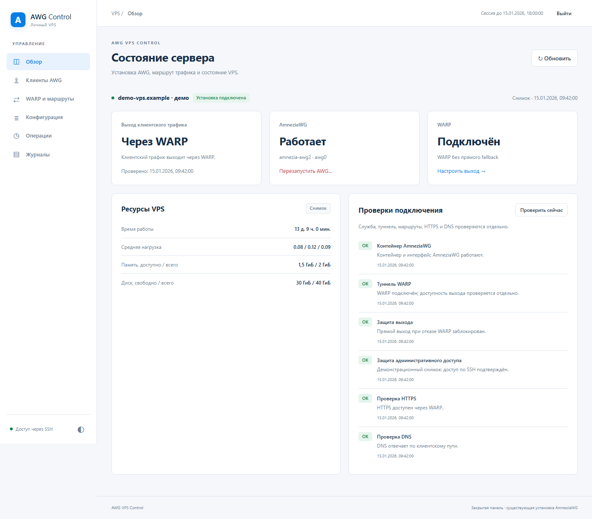
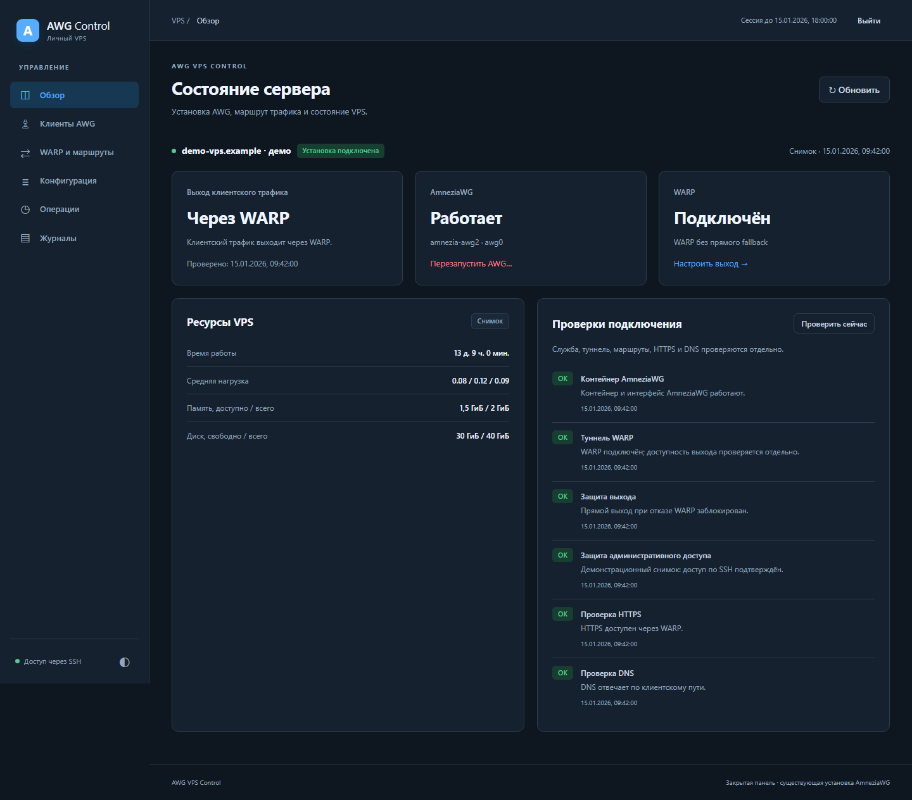
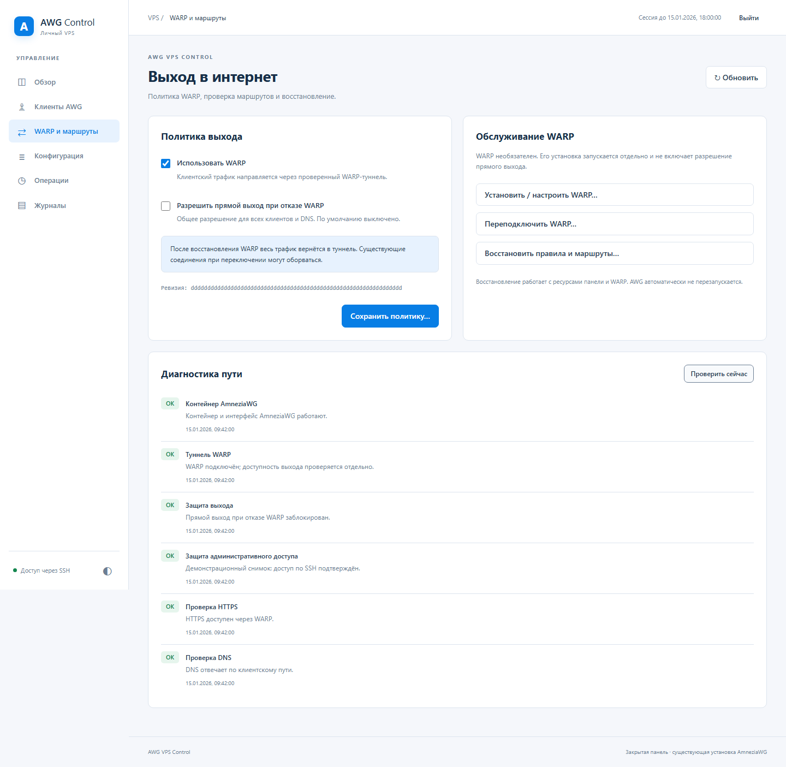

# awg-vps-control

Закрытая веб-панель для управления личным VPS с AmneziaWG и необязательным Cloudflare WARP. Она показывает состояние VPN, проверяет DNS и выход в интернет, восстанавливает собственные маршруты и управляет политикой выхода клиентов. Доступ к панели — через SSH-туннель, без публичного HTTP-порта.

**Текущая версия: `0.1.0-dev.2`. Стабильный выпуск ещё не объявлен.**

На тестовом профиле прошли серверные проверки WARP, прямого резервного выхода, аварийного восстановления и reboot, 45 браузерных проверок обновлённого UI и 18 HTTP-проверок через JetBrains CLI. Настоящий клиент Amnezia на Windows подключился: подтверждены свежий handshake, трафик и выход через WARP. Остались отдельная клиентская DNS-проба, IPv6 и административные исключения. Подробные результаты и границы проверок — в [протоколе готовности](docs/verification_status.md).

## Возможности

- Обзор VPS, существующего AWG, WARP и состояния сетевой интеграции.
- Подключение существующих AWG/DNS-контейнеров служебной CLI-командой без замены ключей, конфигурации и peers.
- Просмотр штатного списка клиентов Amnezia и конфигурации со скрытыми секретами.
- Проверка HTTPS и DNS из клиентской подсети, диагностика и журналы операций.
- Работа без WARP либо выход клиентов через официальный WARP на хосте.
- Блокировка прямого выхода при отказе WARP; автоматический direct fallback только по явному разрешению пользователя.
- Автоматическое восстановление собственных правил и возврат всего клиентского трафика в исправный WARP.
- Независимый аварийный таймер для изменений WARP с подтверждением нового SSH-подключения.
- Отдельная ручная установка нового AWG и AmneziaDNS в Docker из закреплённых официальных скриптов Amnezia.
- Установка, обновление и откат панели, ротация доступа, интерактивное меню и команды для автоматизации.

Первый выпуск предназначен для диагностики и восстановления. Создание и изменение клиентов, обновление самого AWG и приложение для компьютера относятся к следующим этапам.

## Требования и совместимость

- Ubuntu 24.04, Linux `amd64`, systemd и рабочий **root SSH-доступ**. Панель устанавливается отдельно на каждом VPS.
- Уже установленные rootful Docker и Docker Compose plugin версии 2 или новее. Проект не устанавливает Docker; rootless Docker и `userns-remap` в первый профиль не входят.
- Существующий AmneziaWG в поддерживаемом Docker-контейнере либо отдельная установка AWG командой `install-awg`.
- Для управляемой маршрутизации: `ip`, `nft`, `iptables-nft`, `ip6tables-nft`, `nsenter`, `curl`, `conntrack`, `sysctl`. Недостающие инструменты проверяются до изменения сети.
- Для установки AWG: доступные `/dev/net/tun` и `/lib/modules`, уже включённый IPv4 forwarding, свободный выбранный UDP-порт и отсутствие существующей установки AWG/DNS. Полный перечень — в [инструкции установки AWG](docs/awg_installation.md).

Поддерживаемая интеграция использует один IPv4-интерфейс AWG, одну или две выделенные Docker bridge-сети и необязательный DNS-контейнер в выбранной сети. Пересечения подсетей, посторонние контейнеры в этих сетях и конфликт владения сетевыми объектами запрещают изменения. Имя контейнера само по себе не определяет версию протокола.

Клиентская маршрутизация в первом профиле — IPv4. Автоматический link-local IPv6 на AWG допускается; клиентский IPv6 ограничивается собственными правилами. Маршрутизируемый IPv6 AWG и IPv6 Docker-сети не принимаются под управление. IPv6 хоста глобально не отключается. Проверка отсутствия обхода политики настоящим IPv6-клиентом ещё не завершена.

WARP необязателен. Проверенный серверный профиль использует официальный Linux client `2026.8.2115.0` в режиме полного туннеля. Proxy mode, Mihomo и установки AWG непосредственно на хосте не входят в этот backend. Подробнее — [совместимость](docs/compatibility.md) и [host runtime](docs/host_runtime.md).

## Быстрый старт

### 1. Получить и установить проверенный bundle

Для текущей dev-версии используйте артефакт **успешного CI для выбранного commit** из [GitHub Actions](https://github.com/khorevaa/awg-vps-control/actions/workflows/test.yml). Артефакт `awg_vps_control_linux_amd64` содержит архив и файл SHA-256. Распакуйте скачанный ZIP на своём компьютере и перенесите оба файла в новый каталог `/root/awg_vps_release` на VPS через существующее SSH/SFTP-подключение.

В root SSH-сеансе на VPS:

```bash
cd /root/awg_vps_release
sha256sum --check awg_vps_control_linux_amd64.tar.gz.sha256
tar -xzf awg_vps_control_linux_amd64.tar.gz
bash release/awg_vps_control.sh install-ui "$PWD/release"
awg-vps-control healthcheck
```

При несовпадении SHA-256 остановитесь. Установщик дополнительно проверяет manifest файлов и готовность сервисов. Go и компилятор на VPS не нужны: bundle содержит готовые бинарники. Установка панели не запускает `install-awg`, не меняет native файлы Amnezia и не включает WARP. Секрет доступа при обновлении сохраняется.

Артефакты CI имеют ограниченный срок хранения. Собрать bundle самостоятельно можно по [инструкции сборки](docs/operations_guide.md#сборка-и-установка-панели); для сборки требуется Go 1.26.9.

После публикации подходящего выпуска в [GitHub Releases](https://github.com/khorevaa/awg-vps-control/releases) менеджер сможет получить его по точному тегу или `latest`:

```bash
# На уже установленной панели, после появления опубликованного выпуска:
awg-vps-control update-ui latest
```

`latest` разрешается через GitHub Releases, а не означает текущую ветку разработки. Если опубликованного выпуска нет, загрузчик сообщает ошибку. Загрузка проверяет SHA-256 архива; источником доверия остаются официальный репозиторий и HTTPS. Формат артефактов и процедура выпуска описаны в [инструкции выпуска](docs/release_guide.md).

### 2. Подключить AWG служебной командой

Если AWG уже работает, выполните на VPS:

```bash
awg-vps-control discover
awg-vps-control attach
```

Диалог предложит выбрать существующий контейнер, Docker-сеть и DNS-контейнер. Если отдельного DNS нет, оставьте соответствующее поле пустым. При наличии DNS выберите сеть, общую для AWG и DNS. Discovery и attach — служебные CLI-шаги установки; отдельной страницы подключения в UI нет.

Если на новом VPS AWG ещё нет, сначала выполните отдельную установку:

```bash
awg-vps-control install-awg --confirm
awg-vps-control attach amnezia-awg2 amnezia-dns-net amnezia-dns
```

Команда устанавливает AWG 3.1 и AmneziaDNS по официальным скриптам Amnezia, проверенным SHA-256. По умолчанию используется UDP-порт `55424`; другой порт задаётся через `--port`. Существующий AWG не заменяется, повторная установка отклоняется. WARP, Docker и клиентские профили эта команда не устанавливает и не создаёт. До установки панели она также доступна как `bash release/awg_vps_control.sh install-awg --confirm`. Подробности — [отдельная установка AWG](docs/awg_installation.md).

Attach сохраняет привязку к ресурсам и исходную ревизию, не изменяя native конфигурацию и клиентов. Для проверки:

```bash
awg-vps-control doctor
awg-vps-control clients
```

### 3. Открыть панель и выбрать режим

```bash
awg-vps-control ui-access
```

Команда автоматически определит SSH-адрес и порт VPS, покажет готовую команду туннеля, локальный URL панели и секрет входа. **SSH-команду выполните на своём компьютере**, затем откройте именно выданный URL и введите секрет. Оставьте туннель работающим, пока пользуетесь панелью. Секрет не передаётся в URL; не публикуйте вывод `ui-access`.

После attach откройте политику выхода в разделе WARP или выполните `awg-vps-control policy`. Для первоначальной работы без WARP явно сохраните этот режим. До выбора панель показывает «Выберите режим выхода»; отсутствие WARP не считается согласием изменить маршруты.

## WARP и политика выхода

WARP устанавливается **на хосте** отдельным действием. Существующая регистрация не сбрасывается автоматически. Перед установкой, явным включением или ручным переподключением WARP нужно создать ограниченное окно безопасности из root SSH-сеанса.

Для первой настройки:

1. Подключите AWG служебной CLI-командой и сохраните режим без WARP.
2. Выполните `awg-vps-control warp-safety arm --seconds 300` и сохраните выданный ID.
3. Выполните `awg-vps-control setup-warp` либо соответствующее действие в UI. Если WARP уже подготовлен, этот шаг можно пропустить.
4. После успешного завершения откройте политику и явно включите WARP. Отдельно выберите, разрешён ли прямой выход при его отказе.
5. Дождитесь завершения операции и диагностики. **Откройте новое TCP SSH-соединение** с компьютера и подтвердите окно до истечения таймера:

```bash
awg-vps-control warp-safety confirm ID_ИЗ_ARM
awg-vps-control warp-safety status
```

Новое SSH-соединение должно быть создано после завершения всей сетевой операции. Новый shell в прежнем SSH multiplex-соединении не подходит. Таймер по умолчанию — 300 секунд, допустимый диапазон — 60–600 секунд. Установка WARP не включает его в политике автоматически.

| Режим | Выход клиентов |
| --- | --- |
| WARP явно выключен | Прямой выход; runtime также отключает туннель WARP |
| WARP включён и проверен | Через WARP |
| WARP неисправен, галочка «Разрешить выход без WARP» снята | Выход блокируется |
| WARP неисправен, галочка установлена | Автоматический прямой выход |
| WARP восстановился и прошёл проверку | Весь трафик возвращается в WARP, прежние direct-соединения прекращаются |
| Галочка снята при включённом WARP | Прямой выход закрывается, включая существующие соединения |

Галочка по умолчанию снята и никогда не включается автоматически. Переключение пути может прерывать загрузки и звонки. Автовосстановление работает с собственными маршрутами, правилами и WARP; оно не перезапускает AWG, Docker или VPS.

### Аварийное удержание

Если окно не подтверждено, независимый таймер сохраняет удержание, блокирует клиентский выход и останавливает WARP. Он работает отдельно от панели и основного WARP runtime. Сохранённая политика и галочка не меняются; автоматического возобновления WARP после удержания нет.

При проблемах с доступом выполните из доступного root SSH-сеанса или консоли провайдера:

```bash
awg-vps-control warp-safety hold
awg-vps-control warp-safety status
```

После завершения аварийного восстановления и проверки доступа команда `awg-vps-control warp-safety resume --seconds 300` из SSH создаёт новое окно. Затем выполните нужное восстановление и снова подтвердите результат через новое SSH-соединение. Если rescue не завершён, `resume` откажет: сначала повторите `hold` и проверьте результат.

Не останавливайте `awg_vps_guard.service` вручную: после интеграции запуск Docker и WARP зависит от этой защиты. Подробный протокол — в [руководстве менеджера](docs/manual_control.md#защита-ssh-перед-изменением-warp) и [описании safety](docs/warp_safety.md).

## Веб-панель

Основные разделы: **Обзор, Клиенты, Конфигурация, WARP, Операции и Журналы**. Панель показывает состояние VPS и VPN, диагностику и результат изменения политики. Поддержаны светлая и тёмная темы, а также узкий экран.

Состояние Connected само по себе не считается подтверждением выхода: диагностика отдельно проверяет HTTPS и DNS. Если часть действия выполнена, но результат не подтверждён, операция получает статус «Требуется восстановление». Откройте диагностику и журнал операции; панель не повторяет неопределённую операцию автоматически. Например, разрешённый клиентский direct может работать, хотя отключение WARP на самом VPS ещё не подтверждено.

Просмотр клиентов использует native данные Amnezia. В этом выпуске панель не создаёт профили и не меняет peers; используйте штатный клиент Amnezia для их подготовки. Серверная HTTPS/DNS-проба дополняет проверку настоящего VPN-клиента и не заменяет её.

### Скриншоты

Текущий интерфейс снят в Chromium со **строго синтетическими демонстрационными данными**. Это иллюстрации возможностей панели, **не доказательство сетевой приёмки**. Реквизиты VPS, ключи, профили и реальные журналы в снимках не используются.

| Обзор — светлая тема | Обзор — тёмная тема | Политика WARP |
| --- | --- | --- |
|  |  |  |

## Управление с консоли

Запустите `sudo awg-vps-control` без аргументов. Меню показывает версию и четыре действия:

1. Установить новый AWG.
2. Установить или обновить панель.
3. Получить доступ к панели.
4. Перезапустить панель.

Остальные операции доступны через именованные команды. Команды управления требуют root:

| Команда | Назначение |
| --- | --- |
| `awg-vps-control status` | Обзор VPS, AWG и WARP |
| `awg-vps-control doctor` | Диагностика сети и причины ошибок |
| `awg-vps-control clients` | Просмотр штатного списка клиентов |
| `awg-vps-control logs` | Журнал восстановления |
| `awg-vps-control discover` / `attach` | Найти и подключить существующий AWG при установке |
| `awg-vps-control policy` | Выбрать режим выхода в диалоге |
| `awg-vps-control setup-warp` | Отдельно установить и подготовить WARP; требуется safety-окно |
| `awg-vps-control repair` | Восстановить собственные маршруты, правила и WARP |
| `awg-vps-control reconnect-warp` | Вручную переподключить WARP; требуется safety-окно |
| `awg-vps-control restart-awg --confirm` | Вручную перезапустить AWG с разрывом клиентских соединений |
| `awg-vps-control ui-access` | Получить URL, секрет и команду SSH-туннеля |
| `awg-vps-control rotate-ui-access` | Заменить секрет и отозвать сессии панели |
| `awg-vps-control healthcheck` | Проверить готовность панели, Adapter, WARP runtime и Docker API |
| `awg-vps-control start` / `stop` / `restart` | Управлять только тремя контейнерами панели |
| `awg-vps-control help` | Все команды и параметры |

Для автоматизации предусмотрены `AWG_VPS_NONINTERACTIVE=1` и JSON-режим чтения. Изменение политики требует актуальной ревизии. Форматы аргументов, переопределение SSH-адреса и команды без работающей панели описаны в [справочнике менеджера](docs/manual_control.md).

## Обновление, откат и удаление панели

Для обновления из нового проверенного bundle:

```bash
awg-vps-control update-ui /root/new_release/release
awg-vps-control healthcheck
```

После публикации выпуска можно вместо каталога передать его точный тег или `latest`. `update-manager` также обновляет менеджер **вместе с согласованными runtime и UI**; это один проверяемый выпуск. Установщик сохраняет доступ и состояние, проверяет готовность новой сборки и при ошибке пытается вернуть предыдущую.

```bash
# Вернуть предыдущий установленный выпуск приложения:
awg-vps-control rollback-ui

# Удалить только контейнеры панели:
awg-vps-control uninstall-ui
```

Откат приложения не откатывает сетевую политику и состояние WARP. Остановка или удаление панели сохраняет AWG, официальный WARP, хостовый supervisor, boot guard и данные. Выбранная политика продолжает работать. Вернуть контейнеры панели можно командой `awg-vps-control start`.

Полного автоматического удаления VPN, WARP и сетевой интеграции нет. Перед ручным восстановлением используйте [руководство эксплуатации](docs/operations_guide.md); не удаляйте state или защитные правила, чтобы обойти отказ проверки владения.

## Архитектура и стек

Проект сохраняет подход [ocserv-vps](https://github.com/khorevaa/ocserv-vps): Bash-менеджер, Go, Unix sockets, SSH-доступ и отдельная закрытая веб-панель. Серверные модули Web и Control используют Go 1.26.9; интерфейс — HTML/CSS/JavaScript без frontend-фреймворка. Python в runtime не требуется.

| Компоненты | Где работают и за что отвечают |
| --- | --- |
| Web, Control, Adapter | Три Docker-контейнера панели без сети, с read-only rootfs и без Linux capabilities. Control и Adapter используют один образ в разных режимах |
| Существующие AWG и DNS | Отдельные native контейнеры Amnezia; установка/обновление панели сохраняет их |
| `warp-svc.service` | Официальный WARP-клиент на хосте; появляется при отдельной установке |
| `awg_vps_warp.service` | Go WARP API и supervisor в одном процессе на хосте |
| `awg_vps_guard.service` | Ранняя защита клиентского выхода до запуска Docker/WARP |

Только Adapter получает Docker socket. Это доверенный доступ уровня root, даже при read-only bind mount; Web и Control его не получают. WARP-клиента внутри контейнеров панели нет. Сервис Web слушает Unix socket, доступный через SSH-туннель.

Публикуемые образы панели — `ghcr.io/khorevaa/awg-vps-web` и `ghcr.io/khorevaa/awg-vps-control`. Установка из bundle строит локальные scratch images из готовых бинарников и не требует скачивания этих образов из GHCR. Версии и артефакты описаны в [инструкции выпуска](docs/release_guide.md).

## Следующие этапы

- Создание, переименование и отзыв клиентов через native `awg0.conf` и `clientsTable`, применение через `awg syncconf`. Отдельной базы VPN-пользователей не будет; одновременная запись из Amnezia и панели не обещается. Клиентский профиль планируется выдавать один раз без хранения приватного ключа для повторного скачивания.
- Приложение для компьютера с профилями VPS, встроенным окном панели и управлением SSH-туннелем.
- Обновление существующего AWG из официальных источников с проверкой сохранности конфигурации и клиентов. Сейчас реализована только отдельная свежая установка.

Эти возможности не входят в текущий выпуск. Порядок и критерии реализации — в [плане разработки](docs/development_plan.md).

## Документация

- [Готовность выпуска и выполненные проверки](docs/verification_status.md).
- [Установка, эксплуатация и ручное восстановление](docs/operations_guide.md).
- [Меню и полный справочник команд](docs/manual_control.md).
- [Отдельная установка AWG из официальных скриптов](docs/awg_installation.md).
- [Совместимость](docs/compatibility.md), [host runtime](docs/host_runtime.md) и [аварийная защита WARP](docs/warp_safety.md).
- [API и Unix-протокол](docs/api.md), [модель WARP](docs/warp_data_model.md) и [состояния операций](docs/operation_states.md).
- [Сборка, контейнерные образы и выпуск](docs/release_guide.md).
- [Исходные решения](docs/source_analysis.md) и [план разработки](docs/development_plan.md).

Реквизиты личных VPS, ключи, токены, клиентские профили и исходные диагностические снимки в репозиторий не включаются.

## Лицензия

Код панели и автоматизации распространяется по лицензии [MIT](license). AmneziaWG, Cloudflare WARP и остальные внешние компоненты распространяются на условиях своих проектов.
